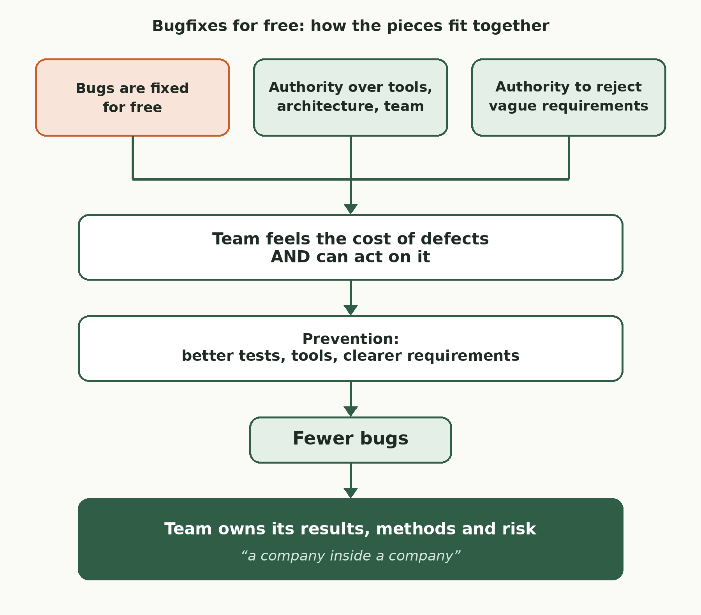

This is bullhit.
What I wanted to express: I want to be free. Freelancer. Not bound by company structure/rules.
Such freelancere fixes bugs for free.

# Forest takeaway: fix bugs for free

I was a software engineer for 16 years.
Recently I started working as a forest worker, and I keep seeing parallels between the two jobs.

## Forest work

I'm a genuine contractor in the forest. There is work that needs to be done, and it's up to me to do it. I'm paid for finished work: the money is agreed up front, and I get neither less nor more.

When, how, with what tools: up to me. Wearing proper protection: up to me. Getting to the forest: up to me.

But most importantly, fixing my own mistakes is up to me.

How does it work?

* If I fell a tree in the wrong direction and spend two more hours getting it out, I do it for free.
* If I plant trees too shallow so they don't thrive, I have to buy a new batch and replant them again. For free.
* If I drive the tractor over a neatly arranged pile of branches, I put them back. Guess what? For free.

I correct my mistakes for free.

## What I mean by "free"

I mean it literally: unpaid work.

The work itself is paid as agreed. Bugs in it, found within an agreed period, are fixed on my own time. And only my own bugs.

## Software world

So why do we pay engineers to fix *their own* bugs?

I don't think engineers are less responsible by nature. I think it's the system. When the cost of a mistake lands somewhere else, and the engineer has no say in how the work is done, the rational response is to patch it and move on. Look at what follows:

**Responsibility.**
"Yeah, mistakes happen, I'll fix it."
Instead of: "I made a mistake. I'll improve so it doesn't happen again."

**Learning.**
"I was told to work this way."
Instead of: "I made a mistake. I need to look at a different architecture or test strategy so it doesn't happen again."

**Innovation.**
"I don't have the power to push a different language, test strategy or architecture."
Instead of: "This approach is prone to errors, so I'm changing it."

**Tools.**
"Nah, AI is just a language model, I'm the programmer."
Instead of: "Does this tool make me faster? Let's give it a try."

People higher in the hierarchy already do these things, because they feel the cost and care about improving processes. Engineers at the end of the chain often don't feel the cost, and often can't act on it. So they do it the way they were told.

## Improving the software world

We can't just tell engineers to fix bugs for free. That would be punishment. It only works when two other things come with it.

### Authority to decide independently

A team must be able to decide independently, as I do in the forest. I can only accept fixing bugs for free when I decide the language, tools, architecture, and maybe even the team composition.

### Authority to reject vague requirements

More often than not, software is described very vaguely.

But when I know I'll fix bugs for free, I simply don't accept vague requirements. I work hard to get everything crystal clear. This goes hand in hand with the authority to decide: a team must be able to say no to vague requirements.

That also answers the question "what is a bug?" A bug is a deviation from what was agreed. If the client changes their mind, it's not a bug. It's a new agreement, and new paid work.

In my experience, spending more time clarifying requirements makes delivery quicker, not slower.

### How it fits together

The three things come as a package. Unpaid fixes make the cost of defects visible. Authority over tools, architecture and requirements lets the team do something about that cost.

A "company inside a company" means exactly that: the team owns its results, its methods and its risk.

## Open points

* The team might hide problems.
    * How do we encourage a team to reveal a problem instead of hiding it?
* How should projects be transferred between teams?
* What is a bug, and what is not?
    * Agreeing on that might take longer than fixing the bug itself.